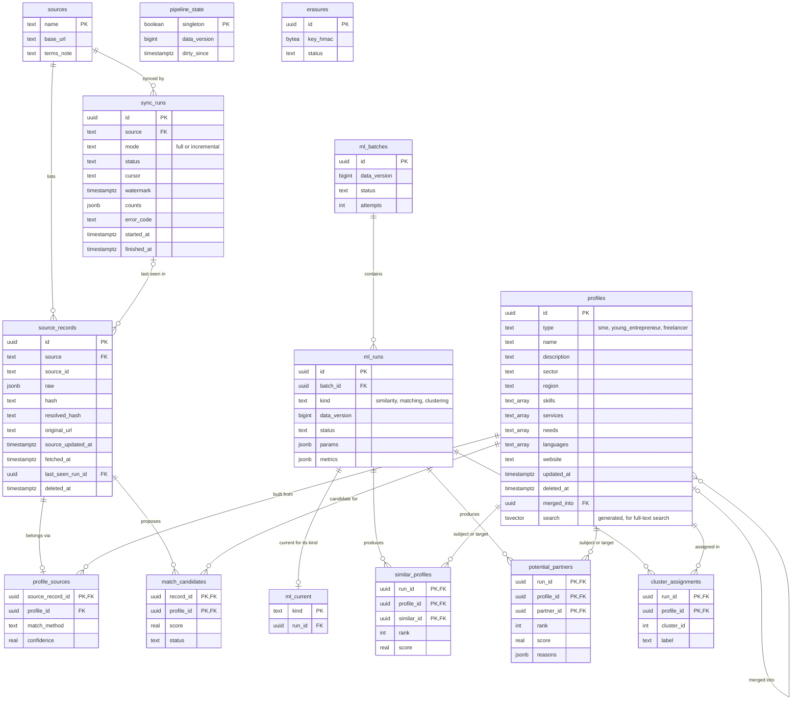

# ER diagram

Column details are in `db/migrations`. `pipeline_state` (one row) and `erasures`
(the blocklist) have no foreign keys.

## Assignment §4.2 fields

| Required field | Where it is stored |
|---|---|
| Unique ID | `profiles.id` |
| Name | `profiles.name` |
| Profile type | `profiles.type` |
| Short description | `profiles.description` |
| Sector | `profiles.sector` |
| Skills | `profiles.skills` |
| Products / services | `profiles.services` |
| Region | `profiles.region` |
| Source name and URL | `sources.name`, `sources.base_url`, via `profile_sources` and `source_records` |
| Link to the original profile | `source_records.original_url` |
| Last update | `profiles.updated_at`; per source, `source_records.source_updated_at` |

Optional fields kept: languages (`profiles.languages`), wanted partnerships and
technology needs (`profiles.needs`), website (`profiles.website`).

## Tables the assignment names

| §6 table | Written by |
|---|---|
| `similar_profiles` | Spark similarity job |
| `potential_partners` | Spark matchmaking job |
| `cluster_assignments` | Spark clustering job |
| `sync_runs` | API (`/sync/{source}`) and the worker, one row per import |
